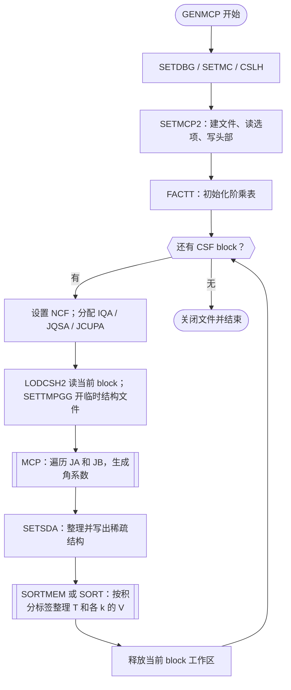

# rangular 计算流程、核心例程与共享状态

核查日期：2026-11-10。源码基准：`d181bf4c14c6aecf55f5549cc1faebabd75cb095`。

后续更新：普通串行入口已增加可选的描述符二进制加载和阶段计时，见
[描述符输入与验证](rangular_descriptor_input.md)。下文原角系数计算/共享状态分析仍适用；
`CSLH/LODCSH2` 是默认文本路径，新增路径向相同内部数组提供数据。
另有独立的 [rangular_omp](rangular_openmp.md) 目标，定向隔离并发调用闭包，按序复用下文的 MCP 提交/排序路径。

初次核查状态：依据源码完成串行主路径的静态梳理；当时没有修改计算实现，也没有运行新的物理计算或性能测试。
本文覆盖普通目标 `rangular`，入口为 `src/appl/rangular/genmcp.f90` 中的
`PROGRAM GENMCP`。不把 MPI、CSFG 程序视为同一实现；共享库只追踪到解释主要计算和状态依赖所需的层次，并非所有深层例程的线程安全审计。

## 1. 程序计算什么

`rangular` 从组态态函数（CSF）的占据数、角动量耦合和对称性信息，生成
Dirac–Coulomb 哈密顿矩阵所需的角系数及稀疏结构。它按对称性 block 处理
CSF 对，将贡献按径向积分标签整理到 `mcp.*` 文件。

这里生成的是角系数，不是给定径向波函数后的完整哈密顿矩阵。
后续 [rmcdhf](rmcdhf_flow_and_state.md) 用当前径向轨道计算积分，再将积分乘以这些系数装配矩阵；部分对角贡献由 `SETHAM` 单独计算。

[构建定义](../../src/appl/rangular/CMakeLists.txt)链接 `rang90`、`mcp90`、
`9290`、`mod`。入口固定 `MYID=0`、`NPROCS=1`；含有按 rank 步进的代码不表示此目标正在并行执行。
`*_I.f90` 是接口单元，不能按文件数当作独立计算步骤。

| 输入或输出 | 作用与主要读写者 |
| --- | --- |
| `rcsf.inp` | `CSLH` 读头部和 block 信息；`LODCSH2` 逐 block 读占据数和耦合数据。 |
| 交互输入 | 全相互作用或一阶相互作用限制；后一种路径通过 `GETINF` 读各 block 的 `ICCUT`。 |
| `mcp.30` | block 元数据和稀疏结构；由 `SETMCP` 初始化，`SETSDA` 追加结构。 |
| `mcp.31` | 按一电子积分标签组织的 T 系数列表。 |
| `mcp.(32+k)` | 按二电子径向积分标签组织的 V(k) 系数列表，`k=0…KMAX`。 |
| `tmp.*` | 当前 block 的临时稀疏结构，以及内存不足转磁盘时的系数记录；正常处理后关闭并删除。 |
| `rangular.log`、可选 `genmcp.dbg` | 交互记录与调试输出。入口的 `SETSUM` 调用已注释，不能据旧注释承诺正常生成 `genmcp.sum`。 |

## 2. 主流程

下图把单个 block 内的成对遍历收在 `MCP` 节点中；完成该 block 的全部系数生成后，才整理其稀疏结构和积分列表。

对应入口：[genmcp.f90](../../src/appl/rangular/genmcp.f90)。
`RESTRT` 在入口设为 `.FALSE.`；`MCP` 的重启分支当前先报告
“Not ready for RESTART”并停止，后面的 `FNDBEG` 不能视为已可用的续算路径。

### 单个 CSF 对的计算

[MCP](../../src/appl/rangular/mcp_gg.f90) 按 `JA=1…NCF`、`JB=1…JA`
遍历三角区域。当前交互路径的 `GETINF` 将 `DIAG=.FALSE.`，对角近似的提问已注释；
代码中仍保留 `DIAG` 筛选分支。若选择一阶相互作用限制，则 `LFORDR=.TRUE.`，
当 `JB>ICCUT(NB)` 时仅保留 `JA=JB`。

对通过筛选的 CSF 对，执行以下步骤：

1. 非对角对调用 `ONESCALAR` 求一电子角系数；只有有效轨道标签及超过
   `CUTOFF=1.0D-10` 的贡献进入 T 列表。
2. 清零共享 `NVCOEF`，调用 `RKCO_GG(JA,JB,CORD,0,1)`，生成二电子角系数。
   `CORD` 是实际传入的回调；深层角动量例程经此路径将结果送入 `SPEAK` 的缓冲区。
3. 遍历 `buffer_C` 中的结果，按截断筛选，规范化轨道标签，过滤在此不存储的
   F0 型直接积分项，再记录积分标签、矩阵位置及系数。
4. 维护 `npos`，保证一个非零 CSF 对对应一个稀疏矩阵位置；多个角系数可以指向同一位置。
   对角元素也进入结构记录。临时结构文件记录 `JA, JB, npos`。

不能将所有循环都理解为“一个 CSF 对输出一个系数”：一个对可能没有非对角贡献，也可能生成多个不同积分标签的系数。

### 缓冲与排序

两层缓冲具有不同生命周期：

- `buffer_C` 的 `LABEL/COEFF` 保存当前 CSF 对的角系数，由 `ALCBUF` 分配、扩容和释放；每对重新设置 `NVCOEF`。
- `sacoef_C` 的 `TCOEFF/IICLMN/IINDEX/ILABEL` 累积整个 block 的结果。
  `MCP` 在容量不足时尝试扩容，失败后将对应列表已有记录及后续记录转写临时文件。
  `MARKT` 和 `MARK(k+1)` 分别记录 T 列表、各阶 V 列表是否走磁盘路径。

所有 CSF 对处理完毕后，`SETSDA` 读临时结构并构造 `IENDC/IROW`；这两个数组在
该例程中是局部指针，不是 `rmcdhf` 的 `hmat_C` 工作区。
随后 T 和每个 k 的 V 列表分别选择 `SORTMEM` 或 `SORT`，形成按积分标签聚集的输出。
矩阵位置、系数与标签的对应关系必须共同保持，不能只对数值数组单独重排。

## 3. 核心例程导航

表中的输入与产物包含通过模块传递的数据，不局限于形参。

| 例程 | 计算职责、输入与产物 | 关键调用或依赖 |
| --- | --- | --- |
| [GENMCP](../../src/appl/rangular/genmcp.f90) | 设置串行上下文，读 CSF 头部，逐 block 调度、分配和清理。 | `CSLH → SETMCP2 → FACTT → LODCSH2 → MCP`。 |
| [SETMCP2](../../src/appl/rangular/setmcp2.f90)、[SETMCP](../../src/appl/rangular/setmcp.f90)、[GETINF](../../src/appl/rangular/getinf.f90) | 建立 MCP 文件，确定 `KMAX`、交互筛选设置和文件头。 | `mcp_C`、`iccu_C`、轨道及 block 元数据。 |
| [MCP](../../src/appl/rangular/mcp_gg.f90) | CSF 对 → T/V 系数、积分标签、稀疏位置及计数；管理缓冲和磁盘回退。 | `ONESCALAR`、`RKCO_GG`、`ALCBUF`、`ALLOCCHECK`、`SETSDA`、排序。 |
| [ONESCALAR](../../src/lib/librang90/onescalar.f90) | 对称性与选择定则筛选；输出一电子轨道标签和 `VSHELL` 系数。 | `SETQNA`、`ONESCALAR1/2`；读取 CSF，改写角动量工作区。 |
| [RKCO_GG](../../src/lib/librang90/rkco_gg.f90) | 两电子角系数生成入口；按占据结构和耦合情况进入不同分支。 | `SETQNA`、`EL1…EL5`、`CORD` 回调；不能只搜 `CALL CORD` 来确定调用图。 |
| [SETQNA](../../src/lib/lib9290/setqna.f90) | 从两个 CSF 提取占据数、壳层和耦合链，写入当前对的共享工作区。 | `m_C` 中 `NQ1/2`、`JJQ1/2`、`JLIST/KLIST`、`JJC1/2` 等。 |
| [CORD](../../src/lib/lib9290/cord.f90)、[SPEAK](../../src/lib/lib9290/speak.f90) | 组织生成的角系数及标签；`SPEAK` 追加到当前对的缓冲。 | `NVCOEF` 增长，必要时 `ALCBUF(2)` 扩容。 |
| [ALCBUF](../../src/lib/lib9290/alcbuf.f90) | 当前对缓冲的分配、扩容、释放。 | `buffer_C` 的指针和容量；与 block 累积缓冲不同。 |
| [SETSDA](../../src/appl/rangular/setsda.f90)、[OUTSDA](../../src/appl/rangular/outsda.f90) | 临时 CSF 对记录 → 稀疏结构和统计；将结构追加到 `mcp.30`。 | 局部 `IENDC/IROW`、顺序文件读取、统计回调。 |
| [SORTMEM](../../src/appl/rangular/sortmem.f90)、[SORT](../../src/appl/rangular/sort.f90) | 将 block 的系数按积分标签整理，追加到最终 MCP 文件。 | 分别使用 `sacoef_C` 内存缓冲或磁盘记录；固定输出单元。 |
| [FACTT](../../src/lib/lib9290/factt.f90)、[SIXJ](../../src/lib/librang90/sixj.f90) | 提供角动量计算所需的表及 6-j 符号。 | 初始化表与按需更新的缓存应区别处理。 |

## 4. 共享状态及生命周期

“共享状态”指例程之间通过模块、持久局部变量或文件连接传递的数据；当前目标本身是串行程序。
下表只将指定变量在指定阶段标为只读，不能由此将整个模块认定为只读。

| 状态及定义 | 谁写、谁读 | 生命周期及并行含义 |
| --- | --- | --- |
| [orb_C](../../src/lib/libmod/orb_C.f90)：`NCF/NW/IQA`、轨道量子数；[stat_C](../../src/lib/libmod/stat_C.f90)：`JQSA/JCUPA`；[hblock_C](../../src/lib/libmod/hblock_C.f90)：block 元数据 | 入口、`CSLH/LODCSH2` 设置；`MCP`、角动量例程读取。 | 当前 block 的 CSF 数组分配后可供成对计算只读使用，`MCP` 结束时释放；跨 block 会重设 `NCF` 和指针。 |
| [mcp_C](../../src/lib/libmod/mcp_C.f90)：`KMAX/DIAG/LFORDR`；[iccu_C](../../src/lib/libmod/iccu_C.f90)：`ICCUT` | `SETMCP/GETINF` 设置，`MCP` 用于筛选和列表维度。 | 设置后在成对计算阶段只读。 |
| [m_C](../../src/lib/libmod/m_C.f90)：占据、壳层列表、耦合链、`NCORE/NPEEL` | `SETQNA` 等改写；`ONESCALAR/RKCO_GG` 及下游读取。 | 随 CSF 对变化的工作区；多个对不能共用同一实例。这里的 `NCORE` 不能仅凭同名就视为入口头部变量。 |
| [dumx_C](../../src/lib/libmod/dumx_C.f90)：`JLIS/JC1S/JC2S` | 角动量调用链读写。 | 与当前对的耦合计算绑定，不能只私有化 `JA/JB` 就消除竞争。 |
| [buffer_C](../../src/lib/libmod/buffer_C.f90)：`NBDIM/NVCOEF/LABEL/COEFF` | `ALCBUF` 管理存储，`SPEAK` 追加，`MCP` 消费。 | 容量、指针及其目标数组都属可变状态；每个并发计算上下文需要独立拥有。 |
| [sacoef_C](../../src/lib/libmod/sacoef_C.f90)：`TCOEFF/IICLMN/IINDEX/ILABEL` | `MCP` 累积/扩容，`SORTMEM` 读取并重排，最后释放。 | 整个 block 的可变输出区；复制每个线程的完整 block 缓冲会放大内存需求。 |
| `MCP` 局部的 `npos/LLISTT/LLISTV/MARKT/MARK` | 每个 CSF 对及缓冲回退路径更新。 | 虽不是模块变量，仍承载跨循环迭代的计数、索引和存储模式依赖。 |
| `SIXJ` 局部缓存 `RACA` | 6-j 计算按需填充并复用。 | 已有 `!$OMP THREADPRIVATE(RACA)`；只有该源文件以 OpenMP 编译时才生效，且不能覆盖调用链其他状态。 |
| 文件连接及当前位置 | `CSLH/LODCSH2`、`MCP`、`SETSDA`、排序及日志例程读写。 | 单元 21 读 CSF，30 读写临时结构，31 及以上用于回退列表，29 追加最终文件；739/99 分别用于日志/调试。不能让多个任务任意共享同一文件位置。 |

这是一份主要状态目录。`EL1…EL5` 更深的依赖、其他初始化缓存、调试分支仍需沿实际并发调用闭包逐项检查。
`USE` 清单或显式形参清单都不能单独证明例程可重入。

## 5. 对后续 OpenMP 分析的直接含义

以下是基于上述依赖的候选设计，尚未实施或计时。

| 候选边界 | 困难程度及原因 | 保持现有行为所需条件 |
| --- | --- | --- |
| 固定 block 内按 CSF 对或按 `JA` 分工 | 高；计算划分清楚，但角动量工作区、系数缓冲、位置编号和输出都可变。 | 先隔离完整角动量工作区；每个任务产出局部记录，再按原遍历顺序分配矩阵位置并提交。 |
| 跨 block 分工 | 高；`NCF`、CSF 指针、共享缓冲和固定文件单元随 block 重用。 | 需要独立 block 上下文及文件提交协议，不能直接给入口 block 循环加指令。 |
| 独立积分列表的排序 | 中到高；列表逻辑上可分，但 `SORTMEM` 共用模块数组和固定输出单元。 | 明确数组切片所有权和输出连接；可先保留串行排序，计时后再决定是否改造。 |

建议先分别计时成对计算、缓冲扩容/磁盘回退、结构生成和排序。
首个原型可采用有界任务批次，避免将整个 `sacoef_C` 按线程完整复制。
“给变量加 `SAVE`”可修复某些串行持久性问题，却不等于线程隔离；
`-fopenmp` 也不会自动消除模块和持久缓存的共享。相关规则见
[OpenMP 数据共享属性](https://openmp.org/spec-html/5.2/openmpsu34.html)及
[GNU Fortran OpenMP 文档](https://gcc.gnu.org/onlinedocs/gcc-15.2.0/gfortran/OpenMP.html)。

验证需要覆盖全相互作用、一阶限制、零贡献对、多 block、内存路径与磁盘回退路径，
检查稀疏结构、积分标签、位置和系数的一致性，并由下游读取验证文件契约。
当前没有热点占比、扩展性或加速比结论。

## 6. 与其他文档的关系

- [rmcdhf 计算流程与共享状态](rmcdhf_flow_and_state.md)：MCP 文件的消费端、径向积分和 SCF 反馈。
- [标准 GRASP 程序接入](standard_grasp_integration.md)：目标、共享库及构建范围。
- [公共参数](common_parameters.md)：统一容量定义和网格设置约束。
- [F2018 迁移计划](../plans/f2018_migration_gfortran15_2026-11-08.md)：串行标准符合性与持久状态审计；通过编译不等于可重入。
- [jj2lsj OpenMP 实现](jj2lsj_openmp.md)：可参考其工作区和有序输出处理，但不能把其验收结果用于证明本调用链线程安全。
