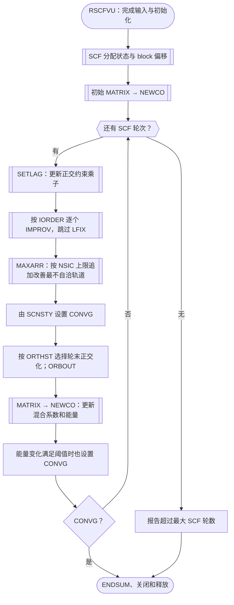

# rmcdhf 计算流程、核心例程与共享状态

核查日期：2026-11-10。源码基准：`d181bf4c14c6aecf55f5549cc1faebabd75cb095`。

状态：依据源码完成普通串行主路径的静态梳理；没有修改计算实现，也没有运行新的物理计算或性能测试。
范围是 `src/appl/rmcdhf/` 的 `rmcdhf` 目标及其主要共享库依赖。
`rmcdhf_mem`、MPI、strict、diag 和 CSFG 目标各有独立实现，不能直接套用本文的控制流或停止判据。
本文是计算与状态导航，不是所有深层例程的完整线程安全证明。

## 1. 程序计算什么

`rmcdhf` 在给定 CSF 空间中迭代改善径向轨道和组态混合系数。
普通 EOL 路径的反馈关系是：

```text
当前径向轨道 + rangular 角系数
    → 径向积分 → 哈密顿矩阵 → 本征值/混合系数
    → 能量权重、有效占据数和轨道方程系数
    → 约束、直接势、交换势 → 逐个改善径向轨道
    → 用更新后的轨道重建矩阵，进入下一轮
```

[rangular](rangular_flow_and_state.md) 生成的角系数在这一过程中复用；
径向积分、矩阵、混合系数和势随 SCF 迭代变化。源码同时保留 EAL 路径，
但当前普通输入链通常进入 EOL，具体条件见下一节。

[构建定义](../../src/appl/rmcdhf/CMakeLists.txt)链接 `dvd90`、`9290`、`mod`。
[入口](../../src/appl/rmcdhf/rscfvu.f90) `PROGRAM RSCFVU` 将
[mpi_s](../../src/appl/rmcdhf/mpi_s.f90) 中 `MYID/NPROCS` 设为 `0/1`；
这些名字和源码中的分工形式不代表此目标实际启动了 MPI。

| 输入或输出 | 作用与主要读写者 |
| --- | --- |
| `isodata` | 核与同位素输入，由 `GETSCD → SETISO` 读取。 |
| `rcsf.inp` | CSF、对称性 block 及占据/耦合信息，由 `SETCSL` 等读取。 |
| `rwfn.inp` | 径向初猜或续算轨道，由 `GETSCD → SETRWFA` 载入。 |
| `mcp.30`、`mcp.31`、`mcp.(32+k)` | 稀疏结构、一电子/二电子角系数及选项元数据；初始化后在矩阵和系数构造中复读。 |
| 可选 `npol.inp` | `NPOL_INIT` 初始化局域核极化修正，并更新核势数组 `ZZ`；输入契约见[核极化说明](rmcdhf_nuclear_polarization.md)。 |
| 交互输入 | 优化目标与权重、冻结轨道、改善顺序、求解方法、阻尼、精度和迭代上限。 |
| `rwfn.out` | `ORBOUT` 在各轮写出当前径向轨道；文件存在并不证明 SCF 已收敛。 |
| EOL 的 `rmix.out` | `SETMIX/MATRIX` 管理并写出混合结果。 |
| `rmcdhf.sum`、`rmcdhf.log`、可选 `rscf92.dbg` | 计算摘要、交互记录和调试输出。 |

## 2. 初始化与 EOL 主流程

入口依次调用 `SETDBG/SETMC/SETCON/SETSUM`，读取 MCP 和 CSF，检查两边的核心轨道数一致，
然后 `GETSCD → STRSUM → SETMIX（仅 EOL）→ FACTT → SCF`。
核心轨道数不一致时直接 `ERROR STOP`。

[GETSCD](../../src/appl/rmcdhf/getscd.f90) 的物理数据初始化顺序为：

```text
SETISO → 设置网格默认值及 ACCY → 可选交互修改
       → SETQIC → RADGRD → NUCPOT → NPOL_INIT → SETRWFA
       → GETOLD 或 GETALD → 设置 SCF/轨道改善控制参数
```

`ACCY=H**6` 的赋值在交互修改网格之前；改变 H 时需要单独提供期望的 ACCY，
不能推断它会自动按新 H 重算，详见[公共参数约束](common_parameters.md)。
核极化初始化失败会停止，尚未进入 SCF。

`GETSCD` 根据 MCP 元数据选择分支：`DIAG=.TRUE.` 时进入 EAL/`GETALD`；
`LFORDR=.TRUE.` 时进入 EOL/`GETOLD`；其余路径当前直接设置 `EOL=.TRUE.`，
原来的 EOL/EAL 提问已注释。当前普通 `rangular` 又将 `DIAG` 设为假，
因此下图描述这条常用输入链的 EOL 执行过程。



### 停止条件与更新次序

[SCF](../../src/appl/rmcdhf/scf.f90) 每轮先完成顺序轨道改善，再按
`NSIC` 上限追加改善当前最不自洽的轨道；`MAXARR` 返回无候选或
`SCNSTY(K)<=ACCY` 时设置 `CONVG=.TRUE.`。随后写轨道，EOL 分支重建矩阵和权重。

普通版本还执行：

```fortran
IF (ABS((WTAEV - WTAEV0)/WTAEV) < 0.001*ACCY) CONVG = .TRUE.
```

因此能量条件可以单独触发停止；它不是“轨道和能量同时满足且连续两轮”的 strict 判据。
`WTAEV0` 在进入循环前置零，之后逐轮更新。达到 `NSCF` 上限仍会进入收尾并保留输出，
但会报告 `Maximum iterations in SCF Exceeded`，不能归为已收敛。

另一个需保留的源码边界是：上述能量判断位于 `IF(EOL)` 外，而本过程的
`WTAEV` 由 EOL 分支的 `NEWCO` 赋值。EAL 分支的该变量定义路径需要单独正确性复核；
本次未执行 EAL，也不将其描述为已验证可用。

## 3. 矩阵、混合系数与径向积分

### MATRIX → SETHAM → MANEIG → NEWCO

[MATRIX](../../src/appl/rmcdhf/matrix.f90) 复位 MCP 文件位置并逐 block 执行：

1. 切换当前 `NCF/NELMNT`，分配并读入 `IROW/IENDC` 等稀疏结构，分配 `EMT`。
2. `SETHAM` 用当前径向轨道生成矩阵元素；返回后 `MATRIX` 计算对角元素的平均值，
   保存到 `EAVBLK`，并从对角线上减去该值。
3. `MANEIG` 求选定的本征态。后续处理包括混合系数阻尼和正交化、结果写出，随后释放该 block 的矩阵工作区。

若某 block 的 `NEVBLK=0`，则消费并跳过它的系数记录，不执行该 block 的矩阵构造和求本征态步骤。

[SETHAM](../../src/appl/rmcdhf/setham.f90) 同时包含两类贡献：

- 用 `IQ/FCO/GCO` 等计算角系数的解析对角项，配合 `RINTI/SLATER` 累加。
- 读 `mcp.31` 的一电子标签及贡献列表，或 `mcp.(32+k)` 的二电子列表；
  每个积分标签计算一次对应径向积分，再按 `INDX` 将 `TEGRAL*COEFF` 加入 `EMT`。

不同积分标签的贡献可以落到相同的 `EMT` 元素，因此“积分可独立算”不意味着
“矩阵可无同步地独立写”。文件当前位置、读取缓冲和矩阵累加也属于该阶段的数据依赖。

[MANEIG](../../src/appl/rmcdhf/maneig.f90) 的路径不能一概称为 Davidson：

- `NCF=1` 为直接处理的特殊情况。
- 当前阈值 `N1000=4000`；`NCF<=4000` 由 `INIEST2` 得到结果，不调用大矩阵 Davidson。
- 较大 block 在初次对角化时用 `INIEST2` 建初猜，后续可复用现有本征向量，
  再调用 `GDVD`，通过回调 `SPICMV2` 计算稀疏矩阵与向量乘积。

[NEWCO](../../src/appl/rmcdhf/newco.f90) 使用新混合系数归一化权重、
计算平均能量 `WTAEV`、有效占据数 `UCF` 和 CSF 权重，供下一轮势与轨道方程使用。

### 积分内核和矩阵乘回调

| 例程 | 输入 → 产物 | 隐含依赖 |
| --- | --- | --- |
| [RINTI](../../src/lib/lib9290/rinti.f90) | 两个轨道标签及当前径向轨道/核势 → 一电子积分。 | `DPBDT`、`QUAD`；使用共享径向临时数组，核势 `ZZ` 含已启用的 NP 修正。 |
| [SLATER](../../src/lib/lib9290/slater.f90) | 四个轨道标签和 k → 二电子径向积分。 | `YZK → QUAD`；读取 `PF/QF` 并写积分工作区。 |
| [YZK](../../src/lib/lib9290/yzk.f90) | 轨道对、k、径向网格 → 径向积分核。 | 使用 `TA/TB/MTP`；按需填充持久网格幂次缓存，内部含递推。 |
| [QUAD](../../src/lib/lib9290/quad.f90) | `TA` 中被积函数、`MTP`、网格及求积系数 → 标量积分。 | 会将 `TA` 尾部补零，不是仅有一个输出形参的无状态纯函数。 |
| [SPICMV2](../../src/lib/lib9290/spicmv2.f90) → [DMERGE](../../src/lib/lib9290/dmerge.f90) | `hmat_C` 稀疏矩阵和一组向量 B → C。 | 利用对称存储；每次 `ICOL` 迭代既写当前分量，也散加到其他分量。 |

## 4. 单轨道改善与径向方程求解

`IMPROV(EOL,J,...)` 是轨道改善的调度例程，不是一个无副作用的“旧轨道 → 新轨道”函数。
它读取当前整组轨道、混合系数和约束，并会影响后续轨道所看到的状态。

```text
IMPROV
  COFPOT
    SETCOF：构造当前轨道的直接、交换和导数项系数
    YPOT / XPOT：构造直接势、交换势
    LAGCON / DACON：加约束与导数项
  DEFCOR：计算延迟修正
  SOLVE：反复试探轨道能量、积分径向方程、匹配与检查节点
  QUAD：计算候选径向函数的范数
  CONSIS：计算 SCNSTY（普通版本在归一化前执行）
  归一化候选 P/Q/P0
  方法切换检查；必要时重试
  DAMPCK / DAMPOR：选择阻尼并写回 wave_C
  若 ORTHST，则 ORTHY：同 kappa 轨道正交化
```

[IMPROV](../../src/appl/rmcdhf/improv.f90) 中，`SOLVE` 失败时若当前方法不是 2，
会改为方法 2，执行 `ORTHSC/SETLAG` 后重试；方法 2 仍失败则 `ERROR STOP`。
方法切换与重试不是只影响局部数组：约束、轨道状态及控制量也可能变化。

[SOLVE](../../src/appl/rmcdhf/solve.f90) 从 `ESTIM/EIGEN` 得到能量估计，
设置势与方程系数，经 `START/OUT/IN` 作起始、向外和向内积分，
按方法处理齐次/非齐次解及变分项，再匹配、求范数、数节点并由 `NEWE` 更新能量，直至成功或报告失败。
`OUT/IN` 和积分核中的网格递推有前后点依赖，不能把所有网格点当作独立任务。

[DAMPOR](../../src/appl/rmcdhf/dampor.f90) 将结果写回 `PF/QF/PZ/MF`；
[ORTHY](../../src/appl/rmcdhf/orthy.f90) 还可能改写同 kappa 的其他轨道。
因此按 `IORDER` 后处理的轨道会读取此前已经更新的轨道。
若改为所有轨道使用同一轮旧快照并同时求解，就改变了迭代算法，需要另外验证收敛行为。

### 核心调度与势构造例程

| 例程 | 计算职责与产物 | 主要状态或调用 |
| --- | --- | --- |
| [RSCFVU](../../src/appl/rmcdhf/rscfvu.f90)、[GETSCD](../../src/appl/rmcdhf/getscd.f90) | 输入检查、网格/核势/初猜、优化方式与控制参数。 | `SETMCP/SETCSL/SETISO/RADGRD/NUCPOT/NPOL_INIT/SETRWFA`。 |
| [SCF](../../src/appl/rmcdhf/scf.f90) | 外层轮次、轨道顺序和追加改善、停止判定及输出。 | `MATRIX/NEWCO/SETLAG/IMPROV/MAXARR/ORBOUT`。 |
| [SETLAG](../../src/appl/rmcdhf/setlag.f90) | 首次建立受约束的轨道对，之后计算正交约束乘子。 | `IECC/ECV`；势、积分及当前轨道工作区。 |
| [SETCOF](../../src/appl/rmcdhf/setcof.f90) | 当前混合系数、占据和角系数 → 当前轨道的 `DA/XA/YA` 及索引列表。 | `FCO/GCO/DSUBRS`、MCP 读取和动态缓冲。 |
| [COFPOT](../../src/appl/rmcdhf/cofpot.f90) | 汇总当前轨道方程所需势与附加项。 | `SETCOF → YPOT → XPOT → LAGCON → DACON`。 |
| [YPOT](../../src/appl/rmcdhf/ypot.f90)、[XPOT](../../src/appl/rmcdhf/xpot.f90) | 系数与径向积分核 → 直接势 `YP`、交换项 `XP/XQ`。 | `YZK`、当前径向轨道；调试分支还有输出。 |
| [LAGCON](../../src/appl/rmcdhf/lagcon.f90)、[DACON](../../src/appl/rmcdhf/dacon.f90)、[DEFCOR](../../src/appl/rmcdhf/defcor.f90) | 约束项、导数项与延迟修正。 | `lagr_C`、`pote_C`、`def_C` 的工作数组。 |
| [IMPROV](../../src/appl/rmcdhf/improv.f90)、[CONSIS](../../src/appl/rmcdhf/consis.f90) | 求候选轨道、计算自洽差异、阻尼与更新。 | 普通版 `CONSIS` 在归一化前；不能套用 strict 版修复后的顺序。 |
| [SOLVE](../../src/appl/rmcdhf/solve.f90)、[OUT](../../src/appl/rmcdhf/out.f90)、[IN](../../src/appl/rmcdhf/in.f90)、[NEWE](../../src/appl/rmcdhf/newe.f90) | 径向方程积分、边界匹配、节点控制和能量迭代。 | `int_C/pote_C/def_C/scf_C`；当前轨道能量 `E(J)`。 |

## 5. 共享状态及生命周期

这里的“共享”首先指串行例程之间的数据传递方式。模块中常混合只读配置、
持久结果和可变工作区，不能给整个模块统一贴上只读或线程私有标签。

| 状态及定义 | 写入者与消费者 | 生命周期与风险 |
| --- | --- | --- |
| [grid_C](../../src/lib/libmod/grid_C.f90)：`N/R/RP/RPOR/H` 等；[npot_C](../../src/lib/libmod/npot_C.f90)：`ZZ` | `GETSCD/RADGRD/NUCPOT/NPOL_INIT` 初始化；积分、势及方程求解读取。 | 在一次固定网格 SCF 中可只读共享；改变网格还必须考虑依赖网格的缓存。 |
| [orb_C](../../src/lib/libmod/orb_C.f90)：量子数、`IQA/NCF`、`E/PED` | CSF 输入设置量子数/占据；`MATRIX` 切换 block；轨道求解更新能量相关量。 | 同时含输入、当前 block 和当前轨道能量，不能将整个模块视为常量。 |
| [wave_C](../../src/lib/libmod/wave_C.f90)：`PF/QF/PZ/MF` | 初猜加载；`DAMPOR/ORTHY/ORTHSC` 改写；所有径向积分和势读取。 | 整个 SCF 生命周期；轮内有顺序依赖，轨道之间并非隔离的输出列。 |
| [eigv_C](../../src/lib/libmod/eigv_C.f90)：`EVAL/EVEC`；[peav_C](../../src/lib/libmod/peav_C.f90)：`EAVBLK`；[def_C](../../src/lib/libmod/def_C.f90)：`WT/WEIGHT` | `MATRIX/MANEIG/NEWCO` 等更新；系数、占据数和能量构造读取。 | 随 EOL 对角化更新；block 偏移决定各结果片段，阻尼还读取上一轮结果。 |
| [hblock_C](../../src/lib/libmod/hblock_C.f90)、[pos_C](../../src/lib/libmod/pos_C.f90)、[blkidx_C](../../src/lib/libmod/blkidx_C.f90) | 输入、根选择及 SCF 建立 block 规模、选根和偏移。 | 大部分映射在本次计算中稳定，但调用者还依赖其他模块里的“当前 block”状态。 |
| [hmat_C](../../src/lib/libmod/hmat_C.f90)：`NELMNT/EMT/IENDC/IROW` | `MATRIX` 分配、装载和释放；`SETHAM` 写矩阵，`SPICMV2` 读取。 | 单个 block 的矩阵上下文；并发 block 不能共用这些指针。 |
| [scf_C](../../src/lib/libmod/scf_C.f90)：`DA/XA/YA`、`NDA/NXA/NYA` 及容量/计数 | `SETCOF` 分配或改写；`YPOT/XPOT/DACON` 消费。 | 当前轨道的系数工作区，下一次构势可覆盖；存在分配与扩容状态。 |
| 同一 `scf_C`：`UCF/METHOD/SCNSTY` 及能量界限 | `NEWCO` 更新有效占据数；轨道改善更新方法、自洽程度和求解边界。 | 有逐轨道持久结果，也有当前求解临时量；划分任务时须逐变量判断。 |
| [pote_C](../../src/lib/libmod/pote_C.f90)：`YP/XP/XQ` | `COFPOT` 调用链生成，`SOLVE` 等使用。 | 当前轨道势工作区；不同轨道的计算会覆盖彼此。 |
| [int_C](../../src/lib/libmod/int_C.f90)：`P/Q/P0/Q0/MTP0/TF/TG/XU/XV` | 方程初始化、积分与匹配例程写；`IMPROV` 归一化和阻尼读取。 | 当前候选轨道和方程工作区，不等同于已提交的 `wave_C`。 |
| [tatb_C](../../src/lib/libmod/tatb_C.f90)：`TA/TB/MTP` | `RINTI/SLATER/YZK/QUAD`、势和归一化等反复读写。 | 最广泛复用的积分临时区之一；仅将顶层积分返回值私有化不能隔离它。 |
| [def_C](../../src/lib/libmod/def_C.f90)：`DP/DQ` 与 `ACCY/NSCF/NSIC/NSOLV` 等 | `DEFCOR` 写修正；初始化设置控制参数；`IMPROV` 可能减少 `NSIC`。 | 常数、控制和临时数组混在同一模块；不能整模块按只读处理。 |
| [lagr_C](../../src/lib/libmod/lagr_C.f90)：`NEC/IECC/ECV` | `SETLAG` 建立/更新；约束项读取；SCF 收尾释放。 | 轨道对列表及乘子跨轨道调用复用，失败重试还可能重新计算。 |
| [orba_C](../../src/lib/libmod/orba_C.f90)、[fixd_C](../../src/lib/libmod/fixd_C.f90)、[damp_C](../../src/lib/libmod/damp_C.f90)、[orthct_C](../../src/lib/libmod/orthct_C.f90) | 输入及改善流程维护 `IORDER/LFIX/ODAMP/CDAMP/ORTHST`。 | 决定顺序、冻结、阻尼和正交化方式；需要与波函数提交时序一起保留。 |
| MCP、混合文件和日志的连接/位置 | `MATRIX/SETHAM/SETCOF` 等读写或复位 MCP；矩阵路径更新混合结果。 | 单元 30 及系数单元 31 以上、混合单元 25 等存在顺序位置；并行调用不能独立控制同一连接。 |

### 模块之外的持久状态

| 例程 | 已见状态 | 审计含义 |
| --- | --- | --- |
| `MATRIX`、`SETLAG`、`DEFCOR` | `FIRST` 等跨调用初始化标记。 | 初始化、重用和重置边界是进程/调用历史相关的，不天然属于独立求解器实例。 |
| `IMPROV` | `DATA` 初始化的 `IPR/ED1/FIRST` 等局部数据。 | 需要检查实际读写用途；局部变量并不都具有每次调用独立的存储。 |
| `YZK` | `SAVE` 的 `KCALC/RTTK/RTTKM/RTTK1/RTTKM1/RM`；`KCALC` 由 `DATA` 初始化。 | 首次使用某阶 k 时填充网格幂次缓存；即便之后只读，首次初始化也不能并发写同一实例。 |
| [DVDSON 及同文件过程](../../src/lib/libdvd90/dvdson.f90) | `SAVE` 声明及驱动/向量更新过程的持久工作状态。 | 不宜直接把整个 Davidson 调用作为可重入的 block 任务；应先审计或封装独立求解器状态。 |

以上为主要计算路径上已确认的状态，并非所有共享库 `SAVE/DATA` 的完整清单。
调试输出、错误恢复、内存扩容和回调同样需要纳入后续并发调用闭包。

## 6. 对后续 OpenMP 分析的直接含义

以下仅为候选边界和静态难度判断，没有实施或速度预测。

| 候选边界 | 困难程度及原因 | 前置条件 |
| --- | --- | --- |
| 固定轨道快照下的一批径向积分 | 中到高；数学输入可固定，但 `TA/TB/MTP`、延迟/积分工作区和 `YZK` 缓存隐式共享。 | 显式工作区或可靠的线程隔离；明确缓存初始化；先分离积分计算与 `EMT` 累加/文件读取。 |
| `SETHAM` 按积分标签分工 | 高；多个标签散加同一矩阵位置，MCP 顺序读取及缓冲增长也共享。 | 预先解析有界批次、定义输出归并顺序，并控制线程局部累加的内存开销。 |
| `SPICMV2` 稀疏矩阵乘 | 中到高；直接并行 `ICOL` 循环时，`DMERGE` 对其他分量的散加产生竞争。 | 选用无冲突表示、局部累加归并或其他明确的同步方案；实际带宽和内存代价需测量。 |
| `SPICMV2` 按向量分工 | 相对清楚，但并行宽度可能不足。 | 不同向量列可分开写；需实测回调的 M，当前 `MANEIG` 设置 `MBLOCK=1`，不能假定每次都有很多向量。 |
| 独立对称性 block 的 CI | 高；当前矩阵指针、block 上下文、文件位置及 Davidson 持久状态共享。 | 独立矩阵/求解器上下文，加上有序输入输出；还需评估多个大矩阵并存的峰值内存。 |
| SCF 外层轨道改善循环 | 很高，涉及算法。 | 除全部工作区隔离外，还须处理轮内新旧轨道依赖、同 kappa 正交化、约束和失败重试；不能仅添加循环并行指令。 |

下一步应先对初始化、每轮 `SETLAG`、轨道改善、`SETHAM`、对角化及输出分段计时，
再决定是否深入积分或矩阵乘内核。没有计时证据时，不能把某个深层调用多的例程直接认定为主要热点。

后续验证至少应区分小 block 与 Davidson 路径、单/多根、多 block、冻结轨道、
阻尼与正交化、失败重试、NP 开关及续算；比较矩阵、能量、轨道、自洽量和迭代轨迹。
浮点累加顺序改变可能影响接近阈值时的停止轮次，因此只比较最终能量不足以确认迭代行为保持一致。
完整 EAL 验证应在定义路径复核后单独安排。

## 7. 与其他文档的关系

- [rangular 计算流程与共享状态](rangular_flow_and_state.md)：角系数、稀疏结构的生成端。
- [核极化接入](rmcdhf_nuclear_polarization.md)：`npol.inp`、核势及当前输入输出约定。
- [strict 求解器](rmcdhf_mem_strict_mpi.md)及[归一化时序修复记录](../reviews/strict_scnsty_normalization_2026-11-09.md)：独立版本的判据和验证，不应套用于本文普通版本。
- [单节点 MPI 诊断计划](../plans/rmcdhf_mpi_single_node_diagnostics_2026-11-09.md)：实际性能现象及待执行诊断，与本次静态流程梳理互补。
- [F2018 迁移计划](../plans/f2018_migration_gfortran15_2026-11-08.md)：标准符合性、接口与状态审计背景；串行正确性和线程安全需分别验证。
