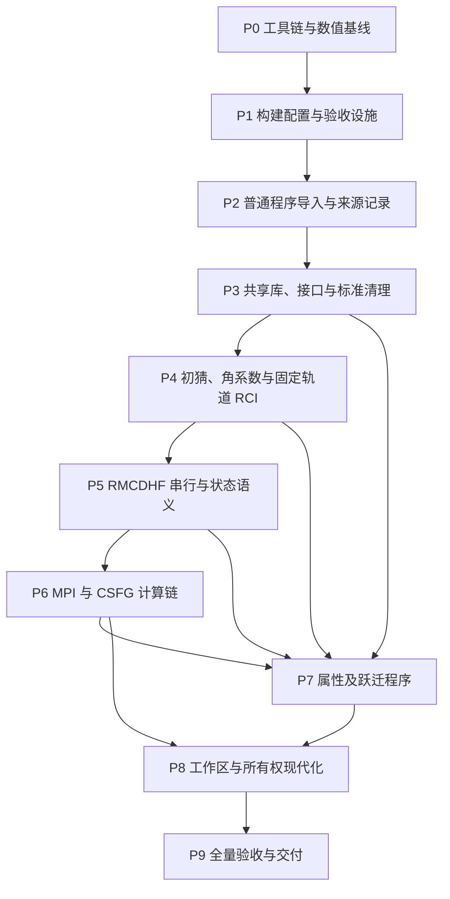

# Fortran 2018 迁移实施计划：gfortran 15 验证基线

日期：2026-11-08。状态：**完整 F2018 迁移待实施；普通程序导入与共享参数准备已部分完成**。
目标仓库：`grasp-atomic-suite`；代码基线：`179ca9ecfd96d54a5617d811b888299a611c13b3`。
本计划中的新增文件、构建选项、测试标签和命令入口，除明确注明“现有”者外，均为拟议交付物。

本次只编写计划并更新文档索引，没有修改计算源码、构建配置或测试实现，没有运行原子计算。
已确认本机 `gfortran-15` 为 **15.3.0**，并完成独立语言特性探针的编译运行和 `mpi_f08` 探针的编译链接；这不构成 suite 构建或数值验收。

上述段落记录初次计划编写。随后按用户的新指示先行导入了 `rangular/rwfnestimate/rbiotransform/rci/rtransition`
五类程序及其变体，并接入现有共享参数；见[实施记录](../implemented/standard_grasp_integration.md)。
第 2 节中的相应“待导入”条目描述原计划，其中这五类的导入部分现已完成；`rhfszeeman95/rsms` 未导入。
这不代表 P2 的全部数值比较已完成，也不代表已启动完整 F2018 语法/接口重构。

## 1. 目标、范围和不可混淆的基线

最终交付为：所有纳入支持清单的计算路径，在固定的 gfortran 15 工具链下完成 F2018 严格构建、独立接口检查、数值回归和数据互读；同时消除对全局隐式静态存储的依赖，逐步明确计算状态及工作数组的所有权。

- **所有新实现、导入和修改均在本仓库内。** 工作区 `grasp/` 只作来源与比较参考；不修改其源码、不复制其 `.git` 或构建产物。
- gfortran **15.3.0** 为首个固定验收版本，其他 15.x 补丁版本需重跑同一验收矩阵；默认 `gfortran` 或 GCC 16 的结果不能替代 GCC 15 验收。ifx/NAG 可作为后续附加检查，不是本计划的必需门槛。
- 保留现有程序名、输入协议、物理常数、核模型、CSF 顺序、截断、默认网格、优化策略与文件格式。经证实的接口缺陷独立修复，记录预期数值变化。
- 不在迁移中改变相关模型、SCF 算法、Davidson 策略、物理算符或引入 GPU/新增计算线程。已有 `jj2lsj_omp` 行为必须保持。
- 保留 `suite_parameters_M.f90` 的唯一容量定义和 `parameter_def_M.f90` 的转导接口；默认 `KEYORB=215, NNNP=590, NNN1=600, NNNW=127`。运行时 `N` 与容量 `NNNP` 分别记录。
- 保留每个网格入口的点核/有限核分支和 ACCY 初始化时序；新增入口登记到参数补丁器。入口总数以源码清单为准，不固化为历史的 8 或 17。
- 使用现有基础共享库；不在新程序目录另建第二套 `libmod/lib9290/libdvd90/mpi90`。保留 GRASPG 专用库和其有意不同的数值实现。

上轮分析针对的是工作区 `grasp/` 的另一份快照，使用 GNU 16.2.1，获得 19 个程序构建成功及 51/1866 个严格检查失败单元。**这些数量不是本仓库、gfortran 15 的结果。** P0 必须重新盘点；计划不能以该统计宣称 suite 已完成任何阶段。

当前依据：[仓库规范](../../AGENTS.md)、[主构建文件](../../CMakeLists.txt)、[参数契约](../implemented/common_parameters.md)、[GRASPG 集成](../implemented/graspg_integration.md)、[NP 集成](../implemented/rmcdhf_nuclear_polarization.md)。

## 2. 程序族与实现位置

| 程序族 | 当前状态 / 实施位置 | 迁移约束 |
| --- | --- | --- |
| 原版 RMCDHF + 可选 NP | 现有 `src/appl/rmcdhf{,_mem,_mpi,_mem_mpi}`，对应同名目标 | 仅这四个保留 NP 输入；不与 orbopt 相互替代 |
| orbopt | 现有 `src/appl/rmcdhf90*` 四目录，目标 `rmcdhf_orbopt*` | 保留事务、节点保护、root tracking 等现有分支；各自建立基准 |
| strict / diag | 现有 `rmcdhf90_mem_strict_mpi`、`rmcdhf90_mem_diag_mpi` | strict 的连续两轮判据和 diag 的输出开关分别回归 |
| 属性计算 | 现有 `rhfs90`、`ris4`、`gj90`、`rdensity`，均有串行/MPI 目标 | 输出单位、核矩约定、对角/非对角元、CI/非 CI 输入均要覆盖 |
| 普通 CSF 后处理 | 现有 `jj2lsj90`，目标 `jj2lsj_omp` | 现有 1/2/4/8 线程逐位一致契约不放宽；无 OpenMP 构建保留 |
| CSFG | 现有 `*csfg*`、`libdvd90mpi`、`src/tool/graspg` | 同一 CSF 展开后的物理空间才可与普通路径比较；不能用基础 `dvd90` 无条件替换专用版本 |
| 普通轨道准备/角系数 | **待导入** `rwfnestimate90`、`rangular90`、`rangular90_mpi` | 新目标 `rwfnestimate`、`rangular`、`rangular_mpi`；不是 CSFG 工具的别名 |
| 普通 RCI | **待导入** `rci90`、`rci90_mpi` | 新目标 `rci`、`rci_mpi`，涵盖 Coulomb、Breit、质量/QED 等现有开关 |
| 普通跃迁链 | **待导入** `rbiotransform90{,_mpi}`、`rtransition90{,_phase,_mpi}` | 保持相位、初末态映射、长度/速度形式及双正交变换语义 |
| 其余原分析中的属性程序 | **待导入** `rhfszeeman95`、`sms90` | 目标 `rhfszeeman95`、`rsms`；与已有 RHFS/RIS 明确功能边界，不悄然删除旧路径 |

`rnucleus/rcsfgenerate` 可暂作固定版本的测试输入准备依赖，不把所有 CSF 生成工具的重构扩大为本次主线。已纳入 suite 默认构建的 CSFG 工具必须通过共享库回归，不能以关闭 `GRASP_BUILD_CSFG` 隐藏破坏。

代码仍在 `src/appl` / `src/lib` 所属位置修改，不另建一套 `src/f2018` 全量副本。基准通过只读归档或独立 checkout 保存，不在同一可执行程序链接两份全局状态。

## 3. gfortran 15 工具链与构建契约

### 3.1 必须记录和检查的内容

P0 保存编译器版本、二进制 hash、实际命令、libgfortran、MPI 版本/构建编译器、MPI 包装器后端、BLAS/LAPACK 实现与整数 ABI、CMake、CPU 架构、线程数和源提交。

本机只读检查发现：`mpifort` 默认后端为 `gfortran`，Open MPI 5.0.11 的记录指向不带版本号的编译器；`mpi_f08` 可用但其 subarray 支持报告为 `no`。本次用 `OMPI_FC=gfortran-15` 编译链接最小探针成功，**仅证明这个探针可以构建**，没有验证 MPI 运行、非连续切片、异步缓冲区或大计数。

正式基准优先使用以 GCC 15 配套构建的 MPI。若复用系统 MPI，必须有供应方兼容依据及 P0 绑定/运行探针；单独覆盖 `OMPI_FC` 不能代替该证明。保存普通 `use mpi` 与 `use mpi_f08`、datatype、collective、1/2-rank 小程序结果。大计数和非连续缓冲区另做能力检查。

构建/测试在独立目录，严禁复用 GCC 16 的 `.mod/.smod/.o`。所有 Python 检查使用工作区 Tools 共享环境，不创建 suite 自己的 venv。

### 3.2 拟议构建配置

在 P1 增加 `cmake/FortranProfiles.cmake` 和 `GRASP_FORTRAN_PROFILE`（**目前不存在**）：

| 配置 | 用途 | 编译/运行要求 |
| --- | --- | --- |
| `legacy` | 保存并重现同版本基线 | 保留原各目标语义；允许原兼容选项，但记录全部警告 |
| `f2018-audit` | 迁移期诊断和进度清单 | 逐目标检查；未迁移依赖明确列入清单，不能报告整套通过 |
| `f2018-check` | 必需正确性门槛 | `-std=f2018 -pedantic-errors -Wall -Wextra -Werror=implicit-interface -Werror=implicit-procedure -O0 -g -fcheck=all -fbacktrace -ffpe-trap=invalid,zero,overflow -fno-fast-math -ffp-contract=off` |
| `f2018-release` | 必需优化构建回归 | 同样标准/接口门槛，显式 `-O2 -fno-fast-math -ffp-contract=off`；剔除 CMake 默认叠加的其他优化选项 |

不全局使用 `-Werror` 强制清理所有无关历史告警；标准扩展、隐式过程/接口、rank/type mismatch、越界、截断和未定义行为相关诊断必须清零。剩余一般告警登记到逐文件清单，禁止静默增加。

正式 `f2018-check/release` 不允许 `-std=legacy`、`-fallow-argument-mismatch`、`-fall-intrinsics` 或全局默认整数/实数扩宽。不依靠 `CMAKE_Fortran_STANDARD` 自动设置标准；检查 `compile_commands.json` 中每个实际编译命令。

`-fno-automatic` 只在 `legacy` 或尚未迁移的隔离目标保留。逐过程确认需要保存的状态，显式保留它们后再移除选项；不能仅为消除与 SAVE 相关的诊断而改变状态寿命。`jj2lsj` 已有 `-frecursive` 及并发调用闭包，P1 不能用新的全局配置覆盖这一设计。

不默认 trap underflow/inexact，不用 `-finit-real=zero` 隐藏初始化缺陷。可设独立 sNaN/整数溢出诊断任务，须说明覆盖边界，不把其通过误解为全程序未初始化检查。

所有非线程专项测试固定 `OMP_NUM_THREADS=1`、`OPENBLAS_NUM_THREADS=1`，禁用数学库动态线程。MPI 测试最少 1/2/4 ranks；线程专项使用 1/2/4/8 threads，避免嵌套线程造成不受控差异。

### 3.3 未来执行命令模板

以下从 suite 根目录执行；**`GRASP_FORTRAN_PROFILE` 和验证脚本必须先由 P1 实现**。`GF15`、`MPI15_FC`、`MPI15_EXEC` 由已验证的本地工具链提供，不在版本库中写入机器绝对路径。

```sh
set -eu
test "$("$GF15" -dumpversion | cut -d. -f1)" = 15
cmake -S . -B build-gf15-check \
  -DCMAKE_Fortran_COMPILER="$GF15" \
  -DMPI_Fortran_COMPILER="$MPI15_FC" \
  -DMPIEXEC_EXECUTABLE="$MPI15_EXEC" \
  -DPython3_EXECUTABLE=../graspkit-tools/.venv/bin/python \
  -DGRASP_FORTRAN_PROFILE=f2018-check \
  -DGRASP_ENABLE_MPI=ON -DGRASP_BUILD_SERIAL_APPS=ON \
  -DGRASP_BUILD_CSFG=ON -DGRASP_JJ2LSJ_OPENMP=ON \
  -DCMAKE_EXPORT_COMPILE_COMMANDS=ON -DCMAKE_BUILD_TYPE=Debug
cmake --build build-gf15-check --parallel 4
ctest --test-dir build-gf15-check --show-only=json-v1
ctest --test-dir build-gf15-check --output-on-failure
```

P1 的验证器先对照 required-targets / required-tests 清单，再运行 CTest：MPI 找不到、测试未注册、skip=77、0 tests 或夹具缺失均不能计为通过。当前 CMake 会在缺 MPI 时继续配置，该行为必须在正式验证配置中升级为明确失败。

`f2018-release` 使用另一个全新 build 目录，运行相同数值测试。不执行 install，直到 P9 验收后才交付独立安装目录；当前 CMake 强制源码目录为安装前缀的问题也在 P1 修复。

版本依据：[GNU 15.2 诊断选项](https://gcc.gnu.org/onlinedocs/gcc-15.2.0/gfortran/Error-and-Warning-Options.html)、[GNU 15.3 存储与运行时检查](https://gcc.gnu.org/onlinedocs/gcc-15.3.0/gfortran/Code-Gen-Options.html)。这些选项不能证明编译器覆盖全部 F2018，验收对象是本项目实际使用的语言子集。

## 4. 基准、夹具和数值验收协议

### 4.1 基准不是单份历史输出

为每个程序族分别保存三类记录：

- `B0`：指定 suite 提交在 GCC 15 legacy 配置下的观测结果；导入程序另有对应来源快照基准。
- `B1`：经独立 oracle 验证的缺陷修正结果。只对明确的缺陷建立，保留 B0 差异，不能覆盖原证据。
- `C`：当前迁移候选。纯重构比较 B1（无已知缺陷时为 B0）；修复缺陷比较 oracle，同时报告与 B0 的变化。

正式验收还需分别建立 `B0-debug/O0`、`B0-release/O2`：基线保留原源码必需的兼容选项，其余优化/浮点/运行设置尽量与候选一致；不要求尚未迁移的 B0 已通过严格标准检查。同配置旧新比较用于隔离源码影响，Check/Release 交叉比较用于隔离优化影响。不能用旧 `-O3` 的结果直接替代新 `-O2` 配置的源码等价基准。

每个 case manifest 固定：源提交、程序变体、编译配置、输入 SHA-256、核模型/核矩、单位、CSF 内容及顺序、网格 `N/NNNP/NNNW/RNT/H/HP/ACCY`、轨道初值/冻结集合/更新顺序、EOL 权重、目标根、截断、Breit/QED/NP 及其他开关、进程/线程数、文件协议和验收阈值。

拟新增 `test/f2018/cases/`、`test/f2018/check.py`、`test/f2018/manifest.schema.json`、`test/f2018/README.md`。小型合成输入可以版本控制；真实输入/大输出存于忽略提交的 `test/data/f2018/` 或外部数据目录，只登记 hash、来源和获取要求。报告放 `docs/reviews/`，不提交机器路径、环境或完整大规模计算结果。

### 4.2 比较规则

**E 类（等价改写）**：同一 GCC 15、数学库、优化级别、rank/线程数和输入下，保持运算顺序的改写要求解码数值逐位一致；有确定性协议的二进制文件逐字节一致。只允许过滤明确列出的时间、耗时、临时路径等元数据，不能过滤能量、警告、迭代数、状态或诊断异常。发生差异即进入定位，不自动降级为宽容差。

**N 类（允许舍入变化）**：仅用于事先声明的归约/优化级别/数据布局变化。标量满足 `abs(x_new-x_ref) <= atol + rtol*max(abs(x_new),abs(x_ref))`；向量和矩阵使用下表指定范数。必须在改代码前登记比较类别，不能看到失败后临时选择更宽规则。

**F 类（缺陷修复）**：必须有最小触发输入和独立 oracle；目标分支以 oracle 为准，其他分支按 E/N 回归。已知错误输出不能成为强制逐位复现的正确性标准。

所有类别均要求有限值、完整记录、正确单位、对称性/选择定则、目标态身份和预期结束状态。非有限值、错根、缺记录、负占据等异常不能被聚合平均误差掩盖。严格程序允许定义明确的异常路径测试，但必须核对其预期状态。

### 4.3 必须保留的已有数值门槛

| 现有测试 | 原有验收标准，迁移时不放宽 |
| --- | --- |
| [lib9290_quad](../../test/lib9290_quad.f90) | 解析积分绝对误差 `<= 1e-12` |
| [rdensity_natural_orbitals](../../test/rdensity/natural_orbitals_test.f90) | 解析占据数、旋转/对角化及正交性相关最大误差 `<= 1e-12` |
| [rdensity regression](../../test/rdensity/regression.py) | 数值差 `<= 2e-10 * max(1,abs(a),abs(b))`，同时保留排序/格式/相位检查 |
| [NP support](../../test/npol/support.f90) | `abs(actual-expected) <= 64*epsilon(actual)*max(1,abs(expected))`，人工软件常数不视为核素参数 |
| [strict restart](../../test/rmcdhf_orbopt/strict_mem_restart.py) | 现有单轨道样例能量差 `<1e-10 Hartree`，P/Q 最大逐点差 `<1e-9`，公共网格点精确一致 |
| [jj2lsj regression](../../test/jj2lsj/check.py) | 系数原始数据、标签和相应科学输出按已有测试逐字节一致，含转换文件回放 |
| [strict_scf_logic](../../test/strict_scf_logic.f90) | 状态转换、首轮、连续次数与停止原因精确一致 |

已有严格 SCF 语义保持为：EOL 轨道条件 `max(SCNSTY) <= ACCY`，能量条件 `abs((E_new-E_old)/E_new) < 0.001*ACCY`，连续两轮同时满足；首轮无有效能量比较，不能继承重启前计数。EAL 使用其既有轨道条件。普通/orbopt 程序保持各自停止规则，不能借迁移将其统一为 strict。[严格程序说明](../implemented/rmcdhf_mem_strict_mpi.md)

### 4.4 新增小型回归的拟定门槛

下表数值是**拟采用的软件回归门槛，不是本次实测结果，也不是物理精度承诺**。适用于 P0 构造的紧凑、条件良好的算例。P0 在未修改算法的 B0 上检查可测量性、输出分辨率及稳定性，并把值冻结到 manifest；不满足的历史模型先诊断/更换合适夹具，不自动放宽。生产体系需要另行固定更适合其数值尺度的预算，不能套用下表宣称物理准确。

| 指标 | N 类新增小型回归门槛 | 计算与边界 |
| --- | --- | --- |
| CSF/块/轨道身份、网格、开关、结构记录 | 精确一致 | 不只比较计数；比较顺序、量子数、映射及输入 hash |
| 角系数/独立径向积分 | `atol=1e-13, rtol=1e-12`（固定该算符的原子单位） | 选择定则的解析零单独检查；角系数相位必须一致 |
| 哈密顿矩阵 | `\|\|H_C-H_R\|\|F / max(1 Ha,\|\|H_R\|\|F) <= 1e-12` | 两侧固定完全相同 CSF、轨道、算符；同时逐元素检查，防止孤立异常被总范数掩盖 |
| 矩阵对称性 | `\|\|H-H^T\|\|F / max(1 Ha,\|\|H\|\|F) <= 1e-13` | 同一物理对称块，不能用对称化后矩阵掩盖构造差异 |
| 固定轨道 RCI 总能量和激发能 | 各自绝对差 `<=1e-10 Ha` | 激发能独立比较，不用巨大总能量作相对分母 |
| CI 求解残差 | 每根 `\|\|Hc-Ec\|\|2 / ((\|\|H\|\|F+abs(E))*\|\|c\|\|2) <=1e-10` | 零分母明确处理；要求夹具求解目标足够严格，不以求解器 success 标志替代 |
| CI 归一化/正交性 | `max\|C^T C-I\| <=1e-12` | 在同一正交 CSF 基下；不得对未归一化旧输出盲目比较 |
| 非简并本征态 | 相位对齐后 `\|\|c_C-s*c_R\|\|2 <=1e-8` | 同 J/宇称内按重叠匹配；能量排序不作为唯一身份 |
| 近简并子空间 | `\|\|P_C-P_R\|\|F <=1e-8` | 簇在基线预先按能隙/目标精度标记；簇内不强制唯一根向量，属性在同一子空间基下比较 |
| 径向归一化和同 kappa 正交性 | 最大偏差 `<=1e-10` | 固定网格和积分规则；P/Q 两分量共同计算 |
| 径向形状变化 | 相位对齐后 `sqrt(integral(deltaP^2+deltaQ^2)dr) <=1e-9` | 同时逐点检查：`\|deltaP/Q\| <=1e-9*max(1,全轨道参考峰值)`；保留尾部/节点诊断 |
| 固定轮次 SCF | 每轮加权能量差 `<=1e-10 Ha`，轨道按上行 | 输入和停止前轮次固定；分支、阻尼、节点处置及根身份变化必须解释 |
| 正常收敛 SCF | 最终加权总能量差 `<=1e-9 Ha`，目标激发能差 `<=1e-10 Ha` | 两侧分别满足自身冻结判据，ITERATION_LIMIT 不能通过；E 类仍要求轮次/轨迹一致 |
| Landé g | 绝对差 `<=1e-10` | 同一算符/修正选项；解析 LS 极限作独立单元测试 |
| 超精细 A/B、同单位非对角元 | `atol=1e-6 MHz, rtol=1e-8` | 比较前显式统一单位和核矩；禁止将不同核参数造成的变化计为语言迁移误差 |
| NMS/SMS、场位移电子矩阵元 | 各算符原子单位下 `atol=1e-12, rtol=1e-8` | manifest 明确算符、量纲及换算常数；各项与总和分别检查 |
| 跃迁约化矩阵元/线强 | 各多极算符的固定原子单位下 `atol=1e-12, rtol=1e-8` | 长度/速度形式分别比较；同一初末态、相位和能量差；解析禁戒零单独测试 |
| 跃迁率/振子强度 | 固定跃迁能量时，非弱线相对差 `<=1e-8` | 弱线以矩阵元/线强绝对预算传播为准；另测使用计算能量时的频率因子，不能重复计入或掩盖误差 |

所有数组比较保存最坏元素位置与分项误差。近零/抵消量以绝对误差和各贡献项检查为主；不除以接近零的参考值。符号仅在参考量显著高于绝对预算时要求一致，解析零按选择定则处理。

哈密顿矩阵的逐元素检查采用 `atol=1e-13 Ha, rtol=1e-12`，与 Frobenius 范数门槛同时成立。新例程的独立解析测试优先使用可精确表示的输入；若解析 oracle 与旧基线冲突，先按 F 类定位，不以旧基线为由修改 oracle。

上述浮点阈值要求读取 binary64 或至少 17 位有效数字的验证输出；若原文本精度不足，先建立测试专用输出/解析通路，不能把四舍五入到相同文本作为通过依据。验证输出不得改变正式文件协议或科学运算。

MPI 1/2/4-rank 与 Check/Release 比较采用同一 N 类预算，不按 rank 或线程数乘大容差。跃迁长度/速度形式相互接近程度属于物理模型诊断，本计划不规定一个通用“规范差必须小于某百分比”的阈值。

### 4.5 必须具备的算例矩阵

| ID | 算例/现有入口 | 主要覆盖 | 状态 |
| --- | --- | --- | --- |
| F00 | 工具链、kind/BLAS/MPI/文件记录小探针 | GCC 15、LP64、接口、环境识别 | 本次仅完成部分语言/链接探针，完整门槛待建 |
| F01 | QUAD、角动量解析值/恒等式、2×2/小块本征问题 | 底层算法、相位、残差 | QUAD 已有，其余补齐 |
| F02 | 现有 synthetic Z=10 有限核 `1s^2` | 初猜、角系数、单轮 SCF、strict/restart、MPI | 脚本已有，本次未运行 |
| F03 | 小型双组态、多根、含近简并块的固定轨道模型 | RCI、根匹配、CI 阻尼触发和 DDOT 修复 | 待新增；需证明确实进入目标分支 |
| F04 | 小型点核/有限核及导入轨道/TF/氢样初猜 | 轨道估计、节点、网格、相位 | 待新增；点核参数选在有良定义解的范围 |
| F05 | `data/test.*` 加可核对核矩的属性小模型 | g、A/B、非对角元、CI/非 CI、RIS 读写 | 现有数据先核对来源与精度；不能因文件存在视为已验收 |
| F06 | 两套轨道的简单允许/禁戒及弱跃迁 | 双正交、phase、两种规范、频率因子 | 待新增 |
| F07 | NP 人工核函数 + 原版四目标 NP off/zero/on | 开关、势/消费者、集体失败 | 单元/消费者测试已有，完整小 SCF 回归待补 |
| F08 | 同一小 CSF 空间的 CSFG 展开比较 | CSFG angular/SCF/两种 RCI/文件映射 | 文件测试已有，真实计算链回归待补 |
| F09 | 参数边界、长路径、空块/空rank、计数分块 | 容量、MPI 生命周期、I/O 错误 | 组合已有测试与新增边界夹具 |
| F10 | Zn I 奇宇称小 MR 多根真实输入 | 实际 SCF/RCI、混合态身份、属性链 | 固定来源及完整输入后建立；本次未运行，不能从旧“跑完”记录直接认证 |

F00–F09 构成可在本地执行的提交/夜间分层门槛，F10 为发布前真实输入回归。大型 active-space 性能和物理收敛研究另列；历史 Ni/Cl 报告或其他输出仅是待核对资料，不能直接充当新工具链正确性 oracle。

## 5. 阶段、依赖关系与退出条件

依赖主线如下；箭头表示前置验收，不能只凭前一阶段“代码已写”就继续发布：



P7 的串行开发可在 P4/P5 后进行，MPI 退出门槛必须等待 P6。阶段内可以按应用逐批完成；共享库的每个变更仍要重测所有已接入消费者。

### P0：固定工具链、来源与可相信的基线

**修改范围**：未来新增 `docs/reference/f2018/` 的来源/目标清单，`test/f2018` 中的 manifest、基准获取和探针；不改计算实现。

**工作**：

1. 固定本计划 suite 提交；对普通 GRASP 待导入源码保存逐文件 hash、许可证和映射。上游无可核验 Git 元数据时用内容 hash，不能用父工作区提交号代替。
2. GCC 15 分别构建当前 serial、MPI、CSFG、OpenMP on/off 组合，记录缺目标/缺测试；重做 F2018 诊断清单，分语法、接口、平台、静态状态和测试缺口。
3. 在相同设置下至少重复两次 B0，记录非确定性；固定小夹具的阈值、输出精度和 oracle。建立正常分支与缺陷触发分支清单。
4. 给当前未注册的 gj90 回归脚本、RIS 数值测试缺口建立明确任务。`tests/gj90_regression.sh` 等条件注册引用不能当成测试已存在。

**依赖**：无代码迁移前置条件。**数值退出**：已有第 4.3 节测试在 GCC 15 下通过或具名定位既有缺陷；F00–F10 所需输入和验收类别已登记，必须覆盖的缺失基准阻止其对应模块进入数值改造。故障样例建立 F 类处理单，不把失败“洗成”基线。

### P1：构建配置和强制验收设施

**修改范围**：顶层及测试 CMake、拟议 profiles 模块、`configure.sh` 必要透传、验收脚本/CI；不改科学算法。

**工作**：落地第 3 节配置；清理全局选项向各目标泄漏；保留 `jj2lsj` 存储例外；隔离 `.mod`；支持独立安装前缀；为必需 MPI、Python、测试/目标集合设置 fail-closed 检查。增加 `f2018_unit`、`f2018_serial`、`f2018_mpi`、`f2018_properties`、`f2018_io`、`f2018_real_case` 测试标签及稳定 required-tests 清单。

**依赖**：P0 工具链与 B0。**数值退出**：legacy 配置与原构建同条件下满足 E 类；无 OpenMP/CSFG/MPI 配置的目标集合准确；迁移前 strict 失败被列出而非隐藏。实际命令确实选择 GCC 15，并无缓存或另一个版本模块污染。

### P2：补齐普通计算链，保持来源可追溯

**修改范围**：第 2 节“待导入”目录及其 CMake、主构建接入、来源清单；按新增网格入口更新 `scripts/patch_grasp_grid.py` 与相应布局测试。

**工作**：每次导入一个程序族，只作路径、模块依赖、目标命名和 suite 参数接口适配；复用已存在的共享库和 MPI helpers。核查局部同名例程，不能误链接别的应用的 `_I` 模块。保存原始来源 hash 与每项适配说明。导入时不顺带修算法或重排计算。

**依赖**：P1；源快照在 P0 固定。**数值退出**：来源与 suite 的比较在 GCC 15、相同容量/网格/运行参数下满足 E 类或预登记 N 类。若来源 NNNW=100 而 suite=127，在独立来源验证副本对齐容量；不得将容量影响混入迁移结论。共享库已有语义差异须列出并以单元 oracle 分离，不保证整个来源输出天然逐位相同。

**交付**：普通与 CSFG 目标并存，测试不再在 PATH 中偶然取得其他版本的 `rwfnestimate/rangular/rci`；未来 `GRASP_PREPARATION_BINDIR` 指向本次构建目录。

### P3：共享库、接口与标准清理

**修改范围**：`libmod`、`lib9290`、`librang90`、`libmcp90`、`libdvd90`，以及必要的 `*_csfg`/`libdvd90mpi` 接口边界；新增明确的 kind、BLAS/LAPACK 和平台适配模块，仍归现有库所有。

**工作**：

1. 清理算术 IF、`INT8/INTEGER*8` 等扩展、声明顺序、FORMAT、续行和 Tab；保留运算/分支次序。现有标准 kind 不因风格而改精度，确认 `DOUBLE` 的 storage/precision/range。
2. 建立 LP64 BLAS/LAPACK 显式接口，审计返回类型、intent、数组关联、工作区长度和字符参数。`DDOT` 的整数返回声明在 suite 多个 RMCDHF/CSFG 变体仍存在，按 F 类单独修复，以 `DOT_PRODUCT`/可精确计算向量为 oracle，并证明进入 CI 阻尼分支。
3. 将内部例程分批转为 module procedures 或由单一来源维护接口；保留过渡调用接口，杜绝 `_I` 与实现签名漂移。
4. 对转换目标审计跨调用状态，显式 SAVE 真正需要保存的局部状态，再移除目标的 `-fno-automatic`。尚未重构的全局模块状态可保留，但必须登记；此阶段不宣称可重入。
5. 处理 `SYSTEM/CHDIR/GETCWD` 的 GNU 扩展：在平台边界采用标准 C 互操作等实现并保留 suite 路径/错误协议。`EXECUTE_COMMAND_LINE('cd ...')` 不能改变父进程工作目录，不能当作 `CHDIR` 的替代。路径需正确引用；mkdir 的退出状态必须区分命令启动失败与命令返回失败。
6. 在 MPI 适配前，先修明确的 datatype handle kind 不一致；`INTEGER(BYTE)` 数据不意味着句柄也是 byte。该修复按独立接口测试验收。

**依赖**：P2 和 P0 oracle。**数值退出**：F01、已有 QUAD/NP/密度单元等按第 4 节通过；纯标准清理满足 E 类；DDOT 等缺陷满足 F 类并保存旧新差异；所有共享库消费者至少完成构建和当前已具备的小回归。strict 配置下不允许用放行选项绕过这些接口。

### P4：轨道估计、角系数与固定轨道 RCI

**修改范围**：导入的 `rwfnestimate90`、`rangular90`、`rci90` 及其应用内接口/I/O；MPI 版本对应纯计算例程同步修正，通信切换留 P6。

**工作**：分别验证读已有轨道、TF、屏蔽氢样初猜；角系数生成/排序/落盘；固定 `.w/.c` 下矩阵构造、稀疏/稠密可用路径与 Davidson/LAPACK 求解。RCI Coulomb-only、Breit on/off 和每个实际支持的质量/QED 修正分别设置非零触发夹具；缺少夹具的分支不能登记“已完成”。

**依赖**：P3。**数值退出**：F01/F03/F04；角系数、轨道、矩阵、CI 残差、激发能及根/子空间分别符合第 4.4 节，旧写新读/新写旧读通过；不能只比较最终总能量。原 MCP/波函数/混合系数记录协议保持。

### P5：RMCDHF 状态与串行行为迁移

**修改范围**：原版/NP 与 orbopt 串行、mem 变体的 `SCF/MATRIX/MANEIG/IMPROV/SOLVE/ORTH*` 等；strict/diag 的纯逻辑和诊断组件；共享 workspace 的必要接口。

**工作**：保持每种 solver 的 EOL/EAL、阻尼、轨道更新、冻结轨道、正交化、失败回退及状态寿命；逐模块移除隐式静态依赖。测试同时覆盖固定轮数与正常收敛，追加进程内重复初始化/执行，暴露错误的持久 FIRST 标志和未释放描述符。

NP off/zero/on 在四个原版目标中分别验证，不能传播到 orbopt；on 的软件测试保持固定人工参数，不据此验证实际核极化模型。strict/diag 不合并到原版主路径。

**依赖**：P4，P3 的缺陷修正基准 B1。**数值退出**：F02/F03/F07；固定轮次轨迹与收敛运行分别验收，轨道形状、归一化、根身份和结束状态必须全部满足第 4 节；strict 首轮/连续两轮逻辑精确一致，diag 开关不改变科学输出。MPI-only solver 的端到端验收尚留 P6，不能提前标绿。

### P6：MPI 绑定、计数和 CSFG 计算链

**修改范围**：`mpi90`、各程序 MPI 入口、`npol_init_mpi`、MPI 专用求解器/CSFG 库。保持现有 `disks/MPI_TMP`、rank 工作目录和 root I/O 协议。

**工作**：

1. 在边界建立 `mpi_f08` 通信层，逐个迁移 communicator/datatype/request/status；旧 integer handle 和新 typed handle 不混传。不能仅替换 INCLUDE 行。
2. count、位移、文件偏移和数组尺寸分开设 kind。乘法前扩大 kind并检查溢出；MPI 大计数重载经过能力探测才启用，否则使用验证过的分块通信。
3. 用小数组和人为较小 chunk 上限覆盖分块算法；单独对 `2^31-1` 两侧做整数运算测试，无需为了接口检查分配数十亿元素。测试不构成实际超大矩阵性能验证。
4. 非连续切片明确 pack/unpack 或验证实现支持；所有 rank 的计数、顺序及错误退出保持集体一致。加入空分区、损坏文件、root 读入失败测试及超时断言，防止死锁。
5. 覆盖全部 RMCDHF MPI 变体、普通 angular/RCI 和 CSFG angular/SCF/两种 RCI。CSFG 专用 `dvd90mpi` 的归约/迭代差异保留，只有等价的展开空间比较矩阵与状态。

**依赖**：P5 和 P4。**数值退出**：F02/F03/F08/F09，1/2/4-rank 均满足同一第 4 节预算；同 rank 的纯通信接口转换先争取 E 类。rank 变化时重新生成匹配的 MCP 文件；不能将不兼容 MCP 重用造成的差异归因于浮点。MPI 错误测试要求全体按预期终止；skip 或未注册都不通过。

### P7：属性、密度与跃迁链

**修改范围**：现有 `rhfs90/ris4/gj90/rdensity`，新导入 `rhfszeeman95/sms90/rbiotransform90*/rtransition90*`，相关接口/读写器和测试。已有 `jj2lsj` 作为共享库消费者回归。

**工作**：补齐真正注册的 g_J 和 RIS 数值测试；A/B 与非对角元、NP 产生轨道的后处理、CI/非 CI 输入、读/生成角向缓存分别覆盖。跃迁先固定轨道与频率测试算符，再测初末态双正交与计算频率，保留 phase 目标的独立约定。

**依赖**：P3/P4/P5；MPI 验收依赖 P6。**数值退出**：F05/F06/F07，加已有 density/jj2lsj；第 4.3 原有门槛全部保留，新属性门槛按第 4.4 节。每种规范独立满足基准；既有近简并态须在共同基/子空间中比较矩阵元。

### P8：计算工作区和内存所有权现代化

**修改范围**：从已验收的共享径向/角向/CI 工作数组开始，逐步引入明确的 grid、orbital set、CSF basis、SCF/RCI workspace；实现仍位于相应现有库/应用。

**工作**：拥有内存的对象改为 allocatable；真实别名/切片保留 pointer 并明确有效期；修复先 NULLIFY 后检查等无效分配保护；通过初始化/销毁接口管理状态，保持旧调用端的适配层。针对 `QUAD` 等隐式读取/写入共享缓冲区的内核，先显式化工作区再评估 `pure`。不批量改为 OOP，不把布局调整与新线程/算法优化放在同一变更。

**依赖**：P6/P7 全部基线稳定。**数值退出**：每次只改一条调用闭包，所有消费者满足 E 类；若确需改变归约顺序，提前登记 N 类并满足同预算。增加重复调用、两个独立 context 交错执行、失败后清理/再初始化测试；分配/释放配对正确，无单调增长的活跃分配。外部库缓存和进程 RSS 分开解释。OpenMP 1/2/4/8 线程 jj2lsj 原逐位契约仍成立。

本阶段结束只能对已消除共享可变状态并完成测试的内核声明可重入，不能将整套程序称为线程安全。

### P9：全量验收、发布与证据归档

**修改范围**：最终配置默认值、验证脚本、文档/索引、来源及变更清单；不夹带算法修改。

**依赖**：P0–P8 全部对应门槛完成。

**退出条件**：

- GCC 15 Check 与 Release 全量干净构建；serial-only、MPI、CSFG on/off、OpenMP on/off 的必需矩阵通过，目标清单与实际一致。
- 所有纳入 scope 的计算源文件均由严格配置覆盖；没有借禁用目标、未构建文件或跳过测试虚报完成。
- 必需 F00–F10 通过，既有全部相关 CTest 通过；skip/expected failure 单独列示，必需成功路径不允许仍是未验证状态。
- 第 4 节误差预算、独立 oracle 和 I/O 往返全部达标；所有预期缺陷修正有输入、差异和正确性证据。
- 性能只报告测量结果，不承诺迁移加速。记录时间、峰值内存和 I/O；显著退化需分析，新增性能优化另开变更。
- 在 `docs/reviews/f2018_gfortran15_validation_<date>.md` 记录提交、工具链、case hash、测试数量/缺项、最大误差、未覆盖范围；更新 `docs/implemented/` 与索引。原计划保留状态及交付链接。
- 经验收后才交付新的独立安装目录；保留旧工具链、原输入和 B0/B1，能够按提交及环境恢复。提交/push/SLURM 作业按实际后续授权执行，本计划不是本轮启动这些操作的指令。

## 6. 特别需要维护的既有保护机制

1. [NP 来源校验](../../test/npol/check_upstream.py) 当前通过去除有限 NP hook 后对照原始源码 hash。语言迁移会合法改变被保护文件，不能简单关掉测试或覆盖历史 hash。保留原始 manifest，另增逐文件迁移记录/补丁及算法回归，重新定义“允许变化且不混入 orbopt”的验证；有意错误回退仍应触发失败。
2. [CSFG 来源清单](../reference/graspg/source-manifest.json) 表示导入前源代码，不改写为当前文件 hash。另记录迁移后的提交/变更映射；原来未启用的源文件不自动进入计算路径。
3. [jj2lsj 构建](../../src/appl/jj2lsj90/CMakeLists.txt) 会重编译部分共享例程形成线程调用闭包；模块化后需核对符号解析和工作区所有权，不能引入第二份全局状态或让 legacy 静态对象替代线程安全对象。
4. [网格补丁器](../../scripts/patch_grasp_grid.py) 和其源模式识别必须随入口/声明变化更新；保持 preview/apply/restore 和省略参数即保留原值的契约。所有容量实验在隔离副本进行。
5. 文件比较覆盖 `.w/.m/.cm/MCP` 及 CSFG 专有记录。普通与 CSFG 输入格式不同，只有明确定义的映射可互转，不能按文件后缀认定兼容。

## 7. 变更拆分、失败处理与完成定义

每个变更提交只承担一种主要行为：构建设施、无语义导入、语法等价清理、接口缺陷修复、状态寿命、MPI 绑定、工作区所有权等分别提交。共享库变更附受影响目标清单及回归结果；不以大规模格式化混入数值修改。

数值失败首先固定输入与工具链，按首次分歧定位：输入/网格 → 角系数/积分 → 矩阵 → 本征态 → 轨道更新 → 属性。保留 stdout、诊断、标准化输出和差异报告。不能通过提高容差、增加 SCF 轮数、改变根选择、阻尼或 CSF 空间来掩盖迁移失败。

出现运行时越界、NaN、错根、协议破坏或未解释的不稳定时，暂停该模块向后传播；恢复到该模块上一已验收提交，在独立修复中解决。其他不依赖它的文档/夹具工作可继续。

本计划的“完成”要求全部 scope 均有构建和数值证据。**F2018 构建通过、数值回归一致、SCF 数值停止、活性空间收敛、物理准确性是不同结论**；发布报告分别陈述，不互相替代。

## 8. 本次计划编写的验证记录

已做：读取 suite 当前源码/构建/测试和现行文档；确认基线提交与原干净状态；检查 GNU 15.3.0 版本；在临时目录用该编译器及拟议 Check 选项编译运行含 `iso_fortran_env`、`implicit none(type, external)`、assumed-rank / `select rank` 的探针，确认 real64/int64 存储各为 64 位；通过指定 GNU 15 后端编译链接 `mpi_f08` 类型/广播探针。

未做：suite 的 GCC 15 全量构建、MPI 探针运行、任何原子计算/数值基准、迁移实现、环境安装或提交。探针不覆盖所有 F2018 特性，也不能证明当前 MPI 栈适合正式验证。P0–P9 均仍为待执行状态。
